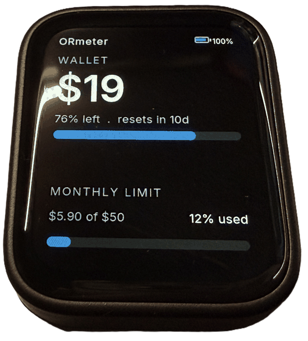

# ORmeter

A desk display for your [OpenRouter](https://openrouter.ai) usage — spend against
your key's limit, and prepaid credit balance — rendered on a small AMOLED panel
and kept current over Bluetooth LE.

The display has no network access and stores no credentials. A small Windows
service reads the OpenRouter API and pushes a compact JSON payload to the meter
over BLE.

```
OpenRouter API  <---  daemon (Windows)  --- BLE --->  ORmeter (ESP32-S3)
```



## What you need

- A **Waveshare ESP32-S3-Touch-AMOLED-1.8**
- A native **Windows** machine with Python 3.10+
- An **OpenRouter API key**, with a spend limit set on it

This project supports exactly that one board.

## 1. Flash the device

Install [PlatformIO](https://platformio.org/), then:

```bash
cd firmware
pio run -e waveshare_amoled_18
```

Write **the application only** — not the merged factory image:

```bash
esptool --chip esp32s3 --port COM7 --baud 921600 \
  write_flash 0x10000 firmware/.pio/build/waveshare_amoled_18/firmware.bin
```

> **Never flash `firmware.factory.bin` at `0x0` on this project.** That merged
> image spans the NVS partition, which erases the device's Bluetooth bond. The
> meter then cannot complete the encryption Windows expects, so every connection
> is dropped about a second after it connects — and it looks like a pairing or
> firmware bug rather than a flashing mistake. Full explanation:
> [docs/flashing.md](docs/flashing.md).

The panel shows the masthead and a wallet figure of `--` until data arrives.

## 2. Pair it with the host

1. On the meter: hold **BOOT** for 3 seconds, then release. The screen counts
   down while you hold, then shows `PAIRING MODE`.
2. On Windows: **Settings → Bluetooth & devices → Add device → Bluetooth**, and
   choose **ORmeter**.

If it doesn't appear, look for a stale `ORmeter` entry in the device list and
remove it first. Windows hides devices it already holds a record for, so a
leftover record makes a perfectly healthy meter look invisible.

Pairing mode stays open for 5 minutes. The bond then persists across reboots and
across reflashes — provided you flash the app only, per the warning above.

## 3. Install the host daemon

```powershell
powershell -ExecutionPolicy Bypass -File install-windows.ps1
```

This builds a virtual environment under `%LOCALAPPDATA%\ORmeter`, copies the
daemon in, and registers it to start at logon. Re-running is safe: it preserves
your config and your API key.

### The OpenRouter API key

The daemon needs a key. It looks in two places, in this order:

1. **`OPENROUTER_API_KEY`** in the environment.
2. **`%LOCALAPPDATA%\ORmeter\.env`** — a file beside its config containing one
   line:

   ```
   OPENROUTER_API_KEY=sk-or-...
   ```

The installer handles this. Pass the key and it writes the file for you:

```powershell
powershell -ExecutionPolicy Bypass -File install-windows.ps1 -ApiKey sk-or-...
```

Without `-ApiKey`, it checks the environment variable, and if that's absent it
tells you exactly which file to create. It never overwrites a key you already
have.

To confirm the key works, without involving the meter at all:

```powershell
& "$env:LOCALAPPDATA\ORmeter\app\.venv\Scripts\python.exe" `
   "$env:LOCALAPPDATA\ORmeter\app\meter_daemon.py" --print-payload
```

That fetches once, prints the JSON payload it would send, and exits.

## Configuration

Settings live at `%LOCALAPPDATA%\ORmeter\config` and are re-read on every poll,
so edits take effect within about a minute with no restart. See
`daemon/config.example`. The option that matters is `wallet_reference`, which
decides what the wallet bar is measured against.

Logs are at `%LOCALAPPDATA%\ORmeter\meter.log`.

## Reading the screen

- **Wallet balance** — the large figure, with a bar beneath it showing the
  balance remaining.
- **Monthly limit** — spend against your key's spend limit, shown as a percentage
  *and* the actual dollars, so the number says what it is a percentage of.
- **Battery** — top right, and drawn only when the AXP2101 reports a cell
  attached. The board runs fine on USB alone, so no indicator means no battery,
  not a fault.
- **Red border** — the whole screen picks up a red frame when the wallet has 5%
  or less left, or the spend limit is 95% or more consumed. Deliberately
  unmissable, and unlike any normal reading.

## Repository layout

| Path | What it is |
|---|---|
| `daemon/` | Windows host service: polls OpenRouter, writes the BLE payload. |
| `firmware/` | ESP32-S3 firmware (PlatformIO): panel, touch, BLE, UI. |
| `assets/fonts/` | Font sources — Inter and JetBrains Mono, both OFL. |
| `docs/` | [Board notes](docs/board.md) and [flashing](docs/flashing.md). |

## Licence

MIT — see [LICENSE](LICENSE). © 2026 RaceFPV
